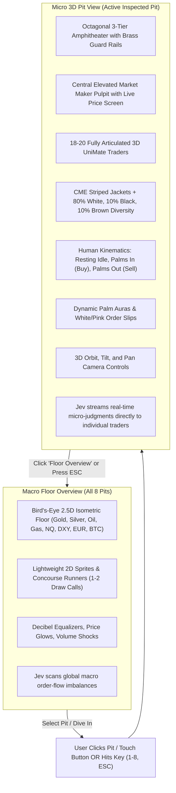

# OpenCry Visual: 3D UniMate Trading Pit Upgrade Plan

## Executive Summary
This document outlines the architectural upgrade path to bring high-fidelity 3D UniMate character models, authentic human kinematics, procedural CME vertical-striped member firm blazers, and authentic demographic representation (80% White, 10% Black, 10% Brown) into the Bevy-powered **OpenCry Visual** trading floor (`opencry-visual`).

The core design principle is **Zero-Latency Jev State Classification**:
Preserving maximum frame budget and 60+ FPS performance so that real-time TypeSafe System One AI models (Jev) can stream order-flow classifications, aggression scores, and crowd reactions without buffering, glitching, or frame drops.

---

## Architecture: Option B (2D Command Floor $\rightarrow$ 3D Pit Deep-Dive)



---

## Pit Population & Resource Budget

In CME/CBOT octagonal amphitheaters and in `opencry-visual`, the realistic population of a single pit is capped at **18 to 22 traders**:

| Position | Role | Count | Visual Behavior |
| :--- | :--- | :---: | :--- |
| **Central Pulpit** | Price Reporter (Exchange Official) | 1 | Elevated on central podium, logging trade tape prints |
| **Top Parapet Rail** | Lead Institutional Floor Brokers | 1 – 2 | Stationed at top rail with sightline to phone banks, leading buy/sell waves |
| **Tier 2 (Middle Step)** | Local Scalpers (Market Makers) | 8 *(1 per facet)* | Competing for 2-way bid/ask spread, flashing hand signals |
| **Tier 3 (Outer Step)** | Locals & Concourse Runners | 8 *(1 per facet)* | Receiving tickets, sprinting along concourses or crowding outer step |
| **Total Active in 3D** | | **18 – 20** | **~324 mesh entities, <2ms frame time in WebGL2 WASM** |

---

## Demographic & Member Firm Jacket Distribution

### Demographics (80 / 10 / 10):
- **White (80%):** 5 authentic skin tones, natural hair palettes (blond, brown, auburn, dark).
- **Black (10%):** Rich melanin tones, black/dark hair caps.
- **Brown (10%):** Mediterranean / South Asian / Hispanic skin tones, dark hair palettes.

### Iconic CME Member Firm Trading Jackets:
1. **Cargill Investor Services:** Candy Stripe (Cargill Red & Pure White)
2. **Dean Witter Reynolds:** Royal Navy & White Vertical Stripes
3. **Carr Futures:** Kelly Green & White Vertical Stripes
4. **First Options of Chicago (FOC):** Vivid Gold & Royal Blue Vertical Stripes
5. **Refco:** Crimson Red & Charcoal Black Vertical Stripes
6. **Sun Trading:** Safety Orange & Dark Navy Vertical Stripes
7. **Official Floor Roles:** Royal Blue (Lead Broker), Kelly Green (Scalper), Vivid Gold (Runner), Burgundy (Price Reporter).

---

## Kinematics & Gesture Mapping

1. **Resting Idle (Vol <= 0.35 or Outside Pit):**
   - Arms hang down naturally at sides with slight forward elbow flexion (~7°).
   - Neutral wrists: Palms turned inward resting gently against thighs.
   - Order tickets tucked away. Natural breathing and subtle weight shift.
2. **Palms In (Buy Imbalance / Bid Burst):**
   - Shoulders flexed forward, elbows bent ~100° bringing hands to chin level.
   - Wrists supinated: **Palms facing inward toward trader's chest**.
   - Waving white CME buy execution slip. Dynamic green palm aura glow.
3. **Palms Out (Sell Surge / Offer Imbalance):**
   - Arms extended forward ~70° and abducted wide ~25° into the pit crowd.
   - Wrists pronated and dorsiflexed: **Palms facing outward into the crowd**.
   - Pushing pink CME sell execution slip. Dynamic red palm aura glow.
4. **Pulpit Logging (Price Reporter):**
   - Anchored on central podium, arms logging prints into exchange tape terminal.
5. **Concourse Sprint (Runners):**
   - Natural athletic stride cycle, counter-twisting torso, tickets gripped in hand.

---

## Integration with TypeSafe AI (Jev)

Jev System One primitives map directly into visual states:

```rust
// Jev Real-Time System One Judgment
pub struct JevPitSentiment {
    pub direction: JevChoice,   // "buy" (Palms In) | "sell" (Palms Out) | "neutral" (Idle)
    pub aggression: f32,        // 1.0 (calm) to 5.0 (frantic shouting)
    pub surge_active: bool,     // Noul p(yes) >= 0.75 -> trigger runners / crowd rush
}
```

---

## Phased Implementation Roadmap

### Phase 1: 3D UniMate Rig & Kinematics in Bevy
- Procedural vertical stripe texture generator (`Assets<Image>`).
- 18-part procedural skeletal mesh hierarchy (`Cuboid` / `Cylinder` primitives with PBR `StandardMaterial`).
- Demographic generator (80% White, 10% Black, 10% Brown).
- Joint forward kinematics system: `update_trader_3d_kinematics`.

### Phase 2: 3D Octagonal Amphitheater Pit
- 3 sunken octagonal steps, brass railings, central pulpit, podium price screen.
- Instantiating 18 traders in authentic tier step positions.
- Lighting rig: Directional hall lighting + localized palm aura point lights.

### Phase 3: Seamless Dual-View Switcher & Orbit Controls
- 3D Orbit Camera (mouse drag to orbit around pit, scroll to zoom, touch navigation).
- UI buttons & keyboard hotkeys (`1-8` for pits, `ESC` to return to floor).
- Smooth transition between 2D floor overview and 3D pit view.

### Phase 4 (Optional Expansion to Option A): Full 3D Hall with Distance LOD
- Replicating 3D pits across the shared concourse.
- Distance-based LOD swapping (distant pits use 1-mesh LOD, active pit uses full 18-part UniMate rig).
