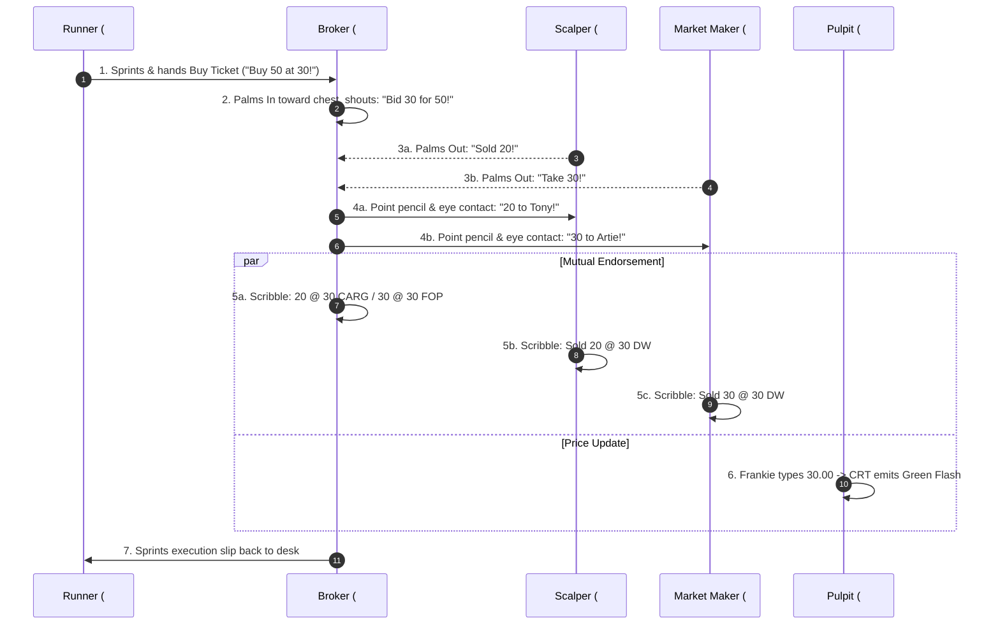

# Chicago Trading Pit Dynamics & Microstructure Guide

> **Note (2026-10-20):** the mechanics, hand-signal and scenario sections of this document are superseded by [`PIT_MICROSTRUCTURE_AND_HISTORICAL_REPLAY.md`](PIT_MICROSTRUCTURE_AND_HISTORICAL_REPLAY.md). See its Appendix A for the specific corrections (price vs quantity signals, the silent 1987 open, roster numbering).
**Authentic Open-Outcry Mechanics, 20-Participant Roster, and 5 Canonical Market Scenarios**

---

## 1. Executive Summary & Microstructural Truth

In modern electronic markets, transactions occur silently inside an matching engine matching orders in microseconds via deterministic price-time priority. 

In a traditional **Open-Outcry Trading Pit** (CME, CBOT, NYMEX, LIFFE), the matching engine was **acoustic, physical, spatial, and visual**:
- **Not a Synchronized Choir:** Traders never stood in unison facing one direction with hands frozen. At any given second, some traders were yelling, others were looking down furiously scribbling on cardboard cards, others were glancing up at the price board, others were locked in intense eye contact making a private bilateral match, and runners were darting along the brass perimeter rails.
- **Physical Hierarchy:** 
  - **Center Ring / Lowest Step (Pit Base):** Heavy Market Makers absorbing massive blocks and spreaders.
  - **Middle Steps (Tiers 1 & 2):** High-speed Scalpers and Day-Locals feeding on 1-tick bid-ask spreads.
  - **Top Step / Outer Rim (Tier 3):** Institutional Floor Brokers with large paper order decks, towering over the pit to spot runner hand signals and broadcast institutional liquidity.
  - **Central Pulpit (Elevated Podium):** Exchange-employed Price Reporters and pit market surveillance typing official prints into the quote tape.
  - **Outer Concourse Rail:** Phone clerks, arbitrage telegraphers, and fleet-footed Runners.

---

## 2. Participant Roster: The 20 Pit Inhabitants

To achieve maximum visual and narrative fidelity without overwhelming WebGL rendering overhead, our pit is modeled with **exactly 20 authentic participants**.

### Demographic Diversity (80/10/10 CME Distribution)
- **16 White (80%)**
- **2 Black (10%)**: Lamar Washington (`#SUN-88`), Reggie King (`#SUN-75`)
- **2 Brown (10%)**: Tariq Al-Mansoor (`#CAR-55`), Devon Patel (`#CAR-95`)

```
                          [PULPIT PODIUM]
                      #0 Frankie "The Tape" (Reporter)
                                   │
              ┌────────────────────┴────────────────────┐
              │             INNER STEP (TIER 1)         │
              │  #7 Artie (MM)   #8 Vic (Spread)   #9 Tariq (MM)
              ├─────────────────────────────────────────┤
              │            MIDDLE STEP (TIER 2)         │
              │  #10 Tony (Scl)  #11 Lamar (Scl)   #12 Devon (Scl)
              │  #14 Mateo (Scl) #15 Garry (Scl)   #18 Boris (Scl)
              ├─────────────────────────────────────────┤
              │             TOP STEP (TIER 3)           │
              │  #3 Jack (Broker) #4 Evelyn (Broker) #5 Marcus (Broker)
              │  #6 Diana (Broker)#13 Hank (Scl)    #16 Sean (Scl)
              │  #17 Reggie (Scl) #19 Jimmy (Flex)
              └─────────────────────────────────────────┘
                                   │
                           [BRASS GUARD RAIL]
                    #1 Billy (Runner)   #2 Sal (Runner)
```

| ID | Name | Role | Tier / Position | Blazer Style | Demographics | Trading Style & Personality |
|---|---|---|---|---|---|---|
| **0** | **Frankie "The Tape" Marino** | Price Reporter | Central Pulpit Desk | Burgundy Solid (`#801020`) | White | CME employee; neutral, hyper-vigilant, types prints into terminal CRT. |
| **1** | **Billy "Wheels" O'Connor** | Concourse Runner | Outer Rail North | Runner Gold (`#D4AF37`) | White | 19-year-old sprinter; ferries institutional buy tickets from wire desk. |
| **2** | **Sal "Express" Greco** | Concourse Runner | Outer Rail South | Runner Gold (`#D4AF37`) | White | Veteran runner; handles executed confirmations and margin call notices. |
| **3** | **Jack "The Bull" Callahan** | Institutional Broker | Tier 3 (North-East) | Dean Witter Blue/White | White | Dean Witter deck broker; executes 500-lot pension fund buy orders. |
| **4** | **Evelyn "The Hammer" Vance** | Institutional Broker | Tier 3 (South-West) | Refco Crimson/Navy | White | Refco lead broker; handles aggressive CTA trend and short sell orders. |
| **5** | **Marcus "Iceberg" Sterling** | Commercial Broker | Tier 3 (North-West) | Solid Royal Blue | White | Works passive limit orders for commercial hedgers and foreign banks. |
| **6** | **Diana "The Wire" Ross** | Arbitrage Broker | Tier 3 (South-East) | Dean Witter Blue/White | White | Watches NY/London squawk box; executes lightning cross-market arbs. |
| **7** | **Artie "The Rock" Baum** | Market Maker | Tier 1 (Center Ring) | First Options Gold/Black | White | 30-year pit veteran; deep pockets, provides liquidity when market panics. |
| **8** | **Vic "Spreadman" Kowalski** | Spread Trader | Tier 1 (Center Ring) | First Options Gold/Black | White | Rarely takes outright directional bets; trades calendar and intercom spreads. |
| **9** | **Tariq "The Balance" Al-Mansoor**| Market Maker | Tier 1 (Center Ring) | Carr Green/White | Brown | Methodical risk manager; balances delta tick-by-tick across tiers. |
| **10**| **Tony "Quick-Tick" Russo** | Local / Scalper | Tier 2 (Step 2 East) | Cargill Red/White | White | Aggressive front-month scalper; in and out of trades within 6 seconds. |
| **11**| **Lamar "Eagle Eyes" Washington** | Local / Scalper | Tier 2 (Step 2 North)| Sun Orange/Blue | Black | Reads broker body language; first to step in front of institutional flow. |
| **12**| **Devon "Flash" Patel** | Local / Scalper | Tier 2 (Step 2 South)| Carr Green/White | Brown | High-dexterity scalper; specializes in rapid 2-lot to 10-lot executions. |
| **13**| **Hank "The Bear" Schmidt** | Local / Scalper | Tier 3 (Step 3 West) | Refco Crimson/Navy | White | Perma-bear local; aggressively hammers bids on the slightest hesitation. |
| **14**| **Mateo "Chop" Hernandez** | Local / Scalper | Tier 2 (Step 2 West) | Dean Witter Blue/White | White | Range scalper; thrives in quiet sessions by making tight 1-tick markets. |
| **15**| **Garry "Nervous" Greene** | Local / Scalper | Tier 2 (Step 2 North)| Emerald Green Solid | White | Undercapitalized, easily rattled; first to bail when volatility spikes. |
| **16**| **Sean "The Kid" Murphy** | Junior Scalper | Tier 3 (Step 3 South)| Cargill Red/White | White | Former clerk, trades small size (1-3 lots); leans on veteran moves. |
| **17**| **Reggie "The Shadow" King** | Local / Scalper | Tier 3 (Step 3 East) | Sun Orange/Blue | Black | Positions directly adjacent to Jack Callahan; shadows institutional bids. |
| **18**| **Boris "The Russian" Vane** | Contrarian Scalper | Tier 2 (Step 2 South)| Cargill Red/White | White | Fades runaway moves; sells into euphoric spikes and buys steep drops. |
| **19**| **Jimmy "The Flex" Doyle** | Dual Trader | Tier 3 (Step 3 North)| Solid Royal Blue | White | Acts as both independent local and overflow broker for regional firms. |

---

## 3. The Anatomy of a Pit Transaction: How Deals Actually Happen

### Is it 1-on-1, 1-to-Many, or Many-to-Many?
Pit trading is a hybrid **two-phase protocol**:
1. **The Broadcast Phase (One-to-Many):** A participant yells a price and quantity to the open crowd. Under exchange rules, all bids and offers must be shouted openly so the entire pit can hear.
2. **The Contestation Phase (Many-to-One):** If the price is attractive, multiple traders shout counter-orders simultaneously ("Take 'em!", "Sold!").
3. **The Matching Phase (Bilateral Match or Multilateral Split):** The initiator locks eyes with one or several respondents, points their pencil, and allocates size.
4. **Inter-Dealer Arbitrage (One-to-One):** Two scalpers standing on the same step frequently trade 1-on-1 quietly with subtle hand taps and nods ("Give ya a half for two" $\rightarrow$ "Done").

### Hand Signals & Physical Vocabulary
- **Palm Direction:**
  - **BUY (Bid):** Palm facing **INWARD toward the trader's own face/chest**. Visual message: *"Bring the contracts to me."*
  - **SELL (Offer):** Palm facing **OUTWARD away from body toward the pit crowd**. Visual message: *"Take these contracts away from me."*
- **Quantity Fingers (Held vertically):**
  - $1$ to $5$: One to five fingers extended straight up.
  - $10$: Touching index finger to chin or clenched fist against chest.
  - $20+$: Flashing finger counts twice or holding out open hands.
- **Price Fraction Fingers (Held horizontally):**
  - Quarter tick ($\frac{1}{4}$): Thumb extended horizontally.
  - Half tick ($\frac{1}{2}$): Thumb and index finger extended.
  - Three-quarters ($\frac{3}{4}$): Three fingers horizontal.
  - Par / Full Tick: Flat hand sliced horizontally across throat.

### The 6-Step Transaction Lifecycle (Sub-Second Flow)


---

## 4. The 5 Canonical Market Scenarios & Pit Dynamics

### Scenario 1: The Lunch Chop (Range-Bound Liquidity / Low Volatility)
- **Market State:** Quiet midday trading. No external macroeconomic news. S&P / Gold oscillating within a tight 2-tick range ($1840.10 - 1840.30$).
- **Overall Pit Posture:** Rhythmic, relaxed, banter-filled. Brokers lean casually against the brass rail checking their watch. Decibel level is low ($45 - 55 \text{ dB}$).
- **Participant Roles & Interactions:**
  - **Brokers (#3 Jack, #4 Evelyn, #5 Marcus):** Sitting on their decks. No fresh institutional size.
  - **Market Makers (#7 Artie, #9 Tariq):** Holding the inside market tight ($1840.10 \text{ bid / } 1840.20 \text{ offer}$).
  - **Scalpers (#10 Tony, #12 Devon, #14 Mateo):** Trading 1-on-1 with each other. Tony buys 2 lots at $.10$ from Artie, holds for 20 seconds, and flips them to Devon at $.20$ for a $\$25$ profit.
  - **Pulpit Reporter (#0 Frankie):** Typing intermittently, leisurely sipping coffee.
- **Sensory & Visual Signatures:**
  - Small arm motions, palms barely raised to chest height.
  - Low conversational murmur; periodic sharp clicks of pencils scratching cards.
  - Pulpit monitor glows a gentle steady cyan.

---

### Scenario 2: The Institutional Bull Surge (Massive Squeeze & Breakout)
- **Market State:** Surging upside momentum. Mega-cap earnings beat or massive foreign asset reallocation. Institutional capital floods the buy side.
- **Overall Pit Posture:** Roaring acoustic wall ($90 - 105 \text{ dB}$). The crowd physically surges forward and upward on the steps. Scalpers who were short scramble to cover at any price.
- **Participant Roles & Interactions:**
  - **Runner (#1 Billy):** Sprints frantically along the concourse, leaps to the brass rail, and flashes open-hand signals across the pit to Jack Callahan.
  - **Broker (#3 Jack Callahan):** Towers on Step 3, raises both arms high above his head, palms facing inward toward his face, screaming at the top of his lungs: *"BID 500 AT 60! FIFTY FOR FIVE HUNDRED!"*
  - **Scalpers (#11 Lamar, #17 Reggie):** Spot Jack's signal early, jump in front, and buy all available offers at $58$ and $59$ before Jack's order hits the pit, pushing the price instantly higher.
  - **Short Scalpers (#13 Hank, #15 Garry):** Caught short. Facial panic. Hands flip from Out (selling) to frantic In (buying to cover): *"Take 'em! I'll pay 62 for 10! Pay 65!"*
  - **Market Maker (#7 Artie Baum):** Steps up to meet Jack's massive order, shouting *"Take 100 at 60!"*, absorbing the shock while adjusting his portfolio delta.
  - **Pulpit Reporter (#0 Frankie):** Fingers flying on the terminal keyboard as the green tape screen flashes continuously.
- **Sensory & Visual Signatures:**
  - Sea of white order slips waving frantically in the air.
  - Traders craning their necks, standing on tiptoes on the step edges.
  - Green neon emissive bloom dominating the central pulpit and podium.

---

### Scenario 3: The Liquidity Vacuum / Flash Crash (Panic Dump)
- **Market State:** Severe geopolitical shock or algorithmic cascading liquidation. Sell orders inundate the floor with zero natural institutional bids.
- **Overall Pit Posture:** Cacophony turning into an eerie, deafening roar of panic. Traders physically back away toward the outer walls; the center ring becomes an empty vortex.
- **Participant Roles & Interactions:**
  - **Broker (#4 Evelyn Vance):** Slamming down sell orders from Refco institutional clients. Palms held out aggressively toward the crowd: *"SELL A THOUSAND AT THE MARKET! WHO'LL TAKE 500?!"*
  - **Scalpers (#10 Tony, #12 Devon, #15 Garry):** Garry Greene throws his pencil in despair and literally cowers against the rail. Tony Russo refuses to quote a bid; hands pressed firmly against his sides. Nobody wants to catch a falling knife.
  - **The Vacuum:** For 4 agonizing seconds, Evelyn screams into a void. Price falls through 10 tick handles without a single print.
  - **Market Maker (#7 Artie Baum & #9 Tariq):** As the price reaches deep value ($30 handles down), Artie Baum locks eyes with Evelyn Vance. He raises one massive hand, palm facing inward: *"I'LL TAKE 200 AT 1810!"* Evelyn instantly points her pencil: *"SOLD!"*
  - **The Rebound:** The moment Artie bids, the scalpers know a floor is found. They rush back to buy the bounce.
- **Sensory & Visual Signatures:**
  - Dominance of pink/blue sell slips thrust outward.
  - Pulpit monitor pulses violent deep crimson.
  - Runners piling up at the brass rail waiting for fills that won't come.

---

### Scenario 4: The Orderly Bear Grind (Institutional Distribution)
- **Market State:** Systematic macroeconomic unwinding. Steady, relentless selling pressure across every bounce. Lower highs, lower lows throughout the session.
- **Overall Pit Posture:** Gritty, adversarial, tension-heavy. Heavy volume but deliberate tempo ($70 - 80 \text{ dB}$).
- **Participant Roles & Interactions:**
  - **Broker (#4 Evelyn & #5 Marcus):** Working disciplined scale-down orders. Evelyn offers 50 lots on every uptick: *"Fifty offered at 45. Still offered at 44."*
  - **Perma-Bear Scalper (#13 Hank Schmidt):** Positioning right next to Evelyn, matching her offers and crushing any bid that attempts to rally.
  - **Dip Buyers (#18 Boris "The Russian"):** Attempting to fade the decline with small 5-lot bids. He gets filled immediately by Hank, only to realize the market is sliding further: *"Damn it, yours at 40!"*
  - **Market Maker (#8 Vic Kowalski):** Active in calendar spreads, buying deferred contracts while selling the prompt month to hedge floor inventory.
- **Sensory & Visual Signatures:**
  - Alternating palm gestures as bids get filled and immediately rolled lower.
  - Steady red/amber flicker on the pulpit screen.
  - Regular rhythm of runner dispatches shuttling confirmation tickets.

---

### Scenario 5: The Fed Rate Shock / Volatility Explosion (Two-Way Whipsaw)
- **Market State:** Exactly 1:00:00 PM CST. Federal Reserve releases FOMC policy rate decision with surprise 50 bps hike and conflicting dovish press wording.
- **Overall Pit Posture:** Absolute pin-drop silence for 2 seconds while eye-balls glue to the wall boards, instantly followed by explosive, deafening pandemonium ($110+ \text{ dB}$). Complete visual frenzy.
- **Participant Roles & Interactions:**
  - **Second 0 - 2 (The Pause):** 20 traders freeze mid-breath. Hands drop. Heads snap toward the electronic wall board.
  - **Second 2 - 5 (The Down-Whip):** Initial 50 bps rate hike headline hits. Brokers scream sell orders: *"Sell 200! Sold! Sold!"* Price plunges 40 ticks in 3 seconds.
  - **Second 6 - 10 (The Up-Reversal):** Wire desk screams that forward guidance is dovish. Jack Callahan (#3) and Diana Ross (#6) receive emergency wire buy tickets: *"BUY 300! BUY EVERYTHING!"*
  - **The Chaos:** Half the pit is screaming BUY (palms in) while the other half is still screaming SELL (palms out). Traders are literally shouting into each other's faces from 6 inches away.
  - **Pulpit Reporter (#0 Frankie):** The quote tape lags reality by 15 seconds. Frankie stands on his desk stamping his foot to establish pit priority and clear the dispute between Tony and Hank over a 50-lot fill.
- **Sensory & Visual Signatures:**
  - Wild, discordant palm waving (alternating green palms in / red palms out).
  - Rapid pulsing between neon green and red on the pulpit CRT.
  - Decibel meter pinned to maximum scale.

---

## 5. Architectural Implementation Matrix: 2D Floor vs 3D Pit

To bring these authentic dynamics into code without sacrificing 60 FPS performance:

| Component | 2D Floorboard Mode (`FloorOverview2D`) | 3D Pit Deep-Dive Mode (`PitDeepDive3D`) |
|---|---|---|
| **Individual Entity Modeling** | 2D instanced sprite icons with firm color borders and role pins. | Articulated 18-part UniMate meshes with striped CME blazers and demographics. |
| **Transaction Choreography** | Visual dynamic vector link arcs between buyer & seller sprite with floating text (`"20 @ 30"`). | **1-on-1 Dynamic Bilateral Facing:** Counterparties smoothly rotate to face each other directly; dominant arm points pencil straight at counterparty chest; luminous 3D deal link beam connects active traders. |
| **Order Slip Visuals** | Color-coded circular pips (white for buy, pink for sell). | 3D rectangular mesh order slips in chunky hands with green/red palm lighting. |
| **Card Endorsement** | Trader icon briefly rotates/bobs downward toward desk/card. | Head/neck pitch tilts down $-25^\circ$; pencil hand scribbles against chest card. |
| **Acoustic / Decibel State** | Decibel meter bar HUD ($0-100\%$) and perimeter floor soundwave glow. | Dynamic directional shouting audio bubbles and trader mouth opening geometry. |
| **Runner Dispatch** | 2D runner sprites pathfinding along concourse corridors to desks. | 3D runners ducking under brass rail and sprinting across concourse perimeter. |
| **Pulpit Synchronization** | Pit center hex ring pulses with price delta color. | Mahogany pulpit CRT monitor emissive material blooms green/red with price text. |
| **TypeSafe AI (Jev) Hook** | Evaluates macro regime (`Score`, `Choice`) to set floor-wide activity & volume. | Classifies individual trader sub-state (`Idle`, `Bidding`, `Selling`, `Scribbling`, `Dispute`). |

---

## 6. Next Implementation Steps

1. **Transaction State Machine (`PitTransactionEngine`):**
   - Implement an event-driven bilateral matching queue where orders originate from brokers/runners, contest across middle scalpers, and resolve with explicit buyer/seller pairs.
2. **Trader Behavioral Micro-States:**
   - Extend `UnimateClip` from simple static loops (`Idle`, `Buy`, `Sell`) to active transaction phases:
     - `Surveying`: Head scanning pit.
     - `Bidding`: Palm in, extended arm, mouth shouting.
     - `Offering`: Palm out, extended arm, mouth shouting.
     - `EyeLock`: Torso oriented directly toward counterparty.
     - `Endorsing`: Head down, writing on trading card.
     - `RunnerHandoff`: Interacting at the brass rail.
3. **Audio-Visual Feedback & Shouts:**
   - Floating comic-style trade confirmation chips (`"+20 DW"`, `"-20 CARG"`) in 3D world space.
   - Dynamic crowd decibel sound synthesis.
